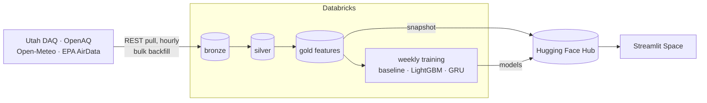

# aq_utah_project: Wasatch Front PM2.5 forecasting

Forecasts PM2.5 24, 48, and 72 hours ahead for monitoring stations across Utah, with the focus on the Salt Lake Valley, where winter inversions and summer wildfire smoke produce some of the worst short-term air quality in the US.

- **Databricks** ingests Utah DAQ, OpenAQ, Open-Meteo, and EPA data every hour, builds bronze → silver → gold Delta tables, and trains models every week.
- **Hugging Face** hosts the trained models, a snapshot of the latest features, and a **Streamlit** app. Enter a zip code, pick a model, and see recent air quality and the forecast.

> **Status:** early build. See [Roadmap](#roadmap).

The design reasoning (requirements, scale estimates, tradeoffs, failure modes) is in **[docs/design.md](docs/design.md)**.

## Architecture



## Layout

| Path | What it does |
|---|---|
| `notebooks/00_setup.py` | Creates the schema and volumes, and checks that secrets exist |
| `docs/design.md` | Design document |
| `databricks.yml` | Asset Bundle defining the jobs |

The notebooks use Databricks **source format**: `.py` files where `# COMMAND ----------` separates cells and `# MAGIC %md` / `# MAGIC %sql` mark Markdown and SQL cells.

## Setup

### 1. Accounts and keys
| Service | Needed for | Key |
|---|---|---|
| Databricks | Pipeline and training | CLI login |
| OpenAQ | Station metadata and measurements | Free API key from explore.openaq.org |
| Hugging Face | Models, feature snapshot, app | Fine-grained write token |
| Utah DAQ, Open-Meteo, EPA AirData | Data | None |

### 2. Connect GitHub ↔ Databricks
1. In Databricks, click your avatar → **Settings → Linked accounts** and connect GitHub.
2. Go to **Workspace → Create → Git folder** and paste this repo's URL.

### 3. Credentials
Databricks reads keys from a secret scope, so they never appear in notebooks:

```bash
databricks secrets create-scope aq
databricks secrets put-secret aq openaq-api-key
databricks secrets put-secret aq hf-token
```

For local exploration, `cp .env.example .env` and fill it in. `.env` is git-ignored.

### 4. Deploy and run
```bash
databricks bundle validate
databricks bundle deploy -t dev && databricks bundle run -t dev aq_hourly   # writes to aq_dev
```

## Cost controls
- Serverless jobs only, no all-purpose clusters left running.
- Hourly job for ingest + features + export. Training is a separate weekly job.
- A budget alert on the Databricks account (Account console → Usage → Budgets).
- Cost per run measured from `system.billing.usage`.

## Roadmap
1. ~~Scaffold: repo, bundle, setup notebook, design doc~~
2. Bronze: Utah DAQ, OpenAQ, and Open-Meteo hourly pulls; EPA AirData backfill
3. Silver and gold: parsing, source reconciliation, hourly alignment, feature table
4. Training: baselines, LightGBM, GRU, MLflow, comparison with the DAQ forecast
5. Serving: export to Hugging Face, Streamlit Space, GitHub Action deploy
