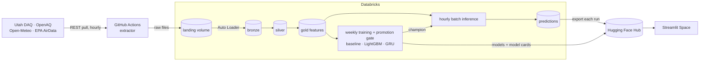

# aq_utah_project: Wasatch Front PM2.5 forecasting

Forecasts PM2.5 24, 48, and 72 hours ahead for monitoring stations across Utah, with the focus on the Salt Lake Valley, where winter inversions and summer wildfire smoke produce some of the worst short-term air quality in the US.

- A **GitHub Actions** extractor pulls Utah DAQ, OpenAQ, and Open-Meteo every hour and lands the raw responses in Databricks.
- **Databricks** loads them with Auto Loader, builds bronze → silver → gold Delta tables, and trains models every week.
- Every hour, the current champion models forecast every station (batch inference). Each forecast is stored and later compared with what actually happened.
- **Hugging Face** hosts the trained models, the latest forecasts, and a **Streamlit** app. Enter a zip code, pick a model, and see recent air quality, the forecast, and how accurate each model has been.

> **Status:** early build. See [Roadmap](#roadmap).

The design reasoning (requirements, scale estimates, tradeoffs, failure modes) is in **[docs/design.md](docs/design.md)**.

## Architecture



## Layout

| Path | What it does |
|---|---|
| `extractor/extract.py` | Fetches the live sources and uploads one raw file per run to the landing volume |
| `.github/workflows/extract.yml` | Runs the extractor hourly |
| `reference/stations.csv` | Monitoring stations: DAQ site name ↔ OpenAQ IDs, coordinates, forecast area |
| `notebooks/00_setup.py` | Creates the schema, volumes, and shared tables; grants the extractor access; checks secrets |
| `reference/daq_unit_overrides.csv` | DAQ sites that report in different units from the rest of the feed, with evidence |
| `notebooks/01_bronze_ingest.py` | Auto Loader: landing files → `bronze_raw`, run metrics → `ops_metrics`, DAQ freshness check |
| `extractor/backfill.py` | One-time history: OpenAQ (AirNow) PM2.5 + NO₂, Open-Meteo forecasts as issued, EPA AirData. Resumable, with a `repair` step |
| `notebooks/02_silver.py` | Parses each source, converts units per site, MERGEs on each table's key into the `silver_*` tables |
| `notebooks/03_gold.py` | One PM2.5 series per station (`silver_readings_best`), then the `gold_features` feature table: lags, rolling stats, forecast weather as issued, labels |
| `docs/design.md` | Design document |
| `databricks.yml` | Asset Bundle defining the jobs |

The notebooks use Databricks **source format**: `.py` files where `# COMMAND ----------` separates cells and `# MAGIC %md` / `# MAGIC %sql` mark Markdown and SQL cells.

## Setup

### 1. Accounts and keys
| Service | Needed for | Key |
|---|---|---|
| Databricks | Pipeline and training | CLI login |
| OpenAQ | Station metadata and measurements | Free API key from explore.openaq.org |
| Hugging Face | Models, feature snapshot, app | Fine-grained write token |
| Utah DAQ, Open-Meteo, EPA AirData | Data | None |

### 2. Extractor service principal
Serverless compute on this workspace can't reach most of the source APIs (see [design doc §5](docs/design.md#5-architecture)), so extraction runs in GitHub Actions.

1. In Databricks: avatar → **Settings → Identity and access → Service principals → Add new**, named `aq-extractor`. Open it → **Secrets → Generate secret**.
2. Put its application ID in `databricks.yml` (`extractor_principal`). The setup notebook grants it read/write on the landing volume, and nothing else.
3. Add GitHub repository secrets:
   ```bash
   gh secret set DATABRICKS_HOST            # https://<workspace>.cloud.databricks.com
   gh secret set DATABRICKS_CLIENT_ID       # the application ID
   gh secret set DATABRICKS_CLIENT_SECRET
   gh secret set OPENAQ_API_KEY
   ```
4. Test it locally without uploading: `python extractor/extract.py --local-dir data/landing`

### 3. Databricks secrets
Databricks reads keys from a secret scope, so they never appear in notebooks:

```bash
databricks secrets create-scope aq
databricks secrets put-secret aq openaq-api-key
databricks secrets put-secret aq hf-token
```

For local exploration, `cp .env.example .env` and fill it in. `.env` is git-ignored.

### 4. Deploy and run
```bash
databricks bundle validate
databricks bundle deploy -t dev && databricks bundle run -t dev aq_hourly   # writes to aq_dev
gh workflow run extract -f schema=aq_dev                                       # one extractor run now
```

## Cost controls
- Serverless jobs only, no all-purpose clusters left running.
- HTTP extraction runs on a free GitHub Actions runner, so Databricks runs only process data.
- Hourly job for ingest + features + export. Training is a separate weekly job.
- A budget alert on the Databricks account (Account console → Usage → Budgets).
- Cost per run measured from `system.billing.usage`.

## Roadmap
1. ~~Scaffold: repo, bundle, setup notebook, design doc~~
2. ~~Bronze: hourly extractor + Auto Loader; backfill of AirNow, EPA AirData, and Open-Meteo history~~
3. ~~Silver and gold: parsing, per-site units, MERGE on keys; EPA reconciliation; gold feature table~~
4. Training: baselines, LightGBM, GRU, MLflow, comparison with the DAQ forecast
5. Serving: export to Hugging Face, Streamlit Space, GitHub Action deploy
