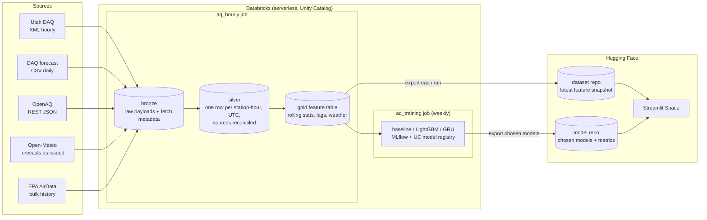

# Design: Wasatch Front PM2.5 forecasting

Status: **draft**. Sections marked *(open)* are still being decided. This document follows the shape of a systems design discussion: requirements first, then estimates, then the design and its tradeoffs.

## 1. Problem

Salt Lake Valley has some of the worst short-term PM2.5 pollution in the US. In winter, temperature inversions trap emissions in the valley for days at a time. In summer, wildfire smoke drives most bad days. Residents decide whether to exercise outside, run an air purifier, or keep kids indoors, and those decisions are made a day or more ahead.

**Goal:** for a user's zip code, show recent air quality and a PM2.5 forecast for 24, 48, and 72 hours out, from more than one model, with honest accuracy numbers next to each.

## 2. Requirements

### Functional
- A user enters a Utah zip code and sees the nearest monitoring station, its recent PM2.5 (current reading and rolling averages), and forecasts at +24h, +48h, and +72h.
- The user can choose which model produces the forecast: a persistence baseline, LightGBM, or a GRU.
- The app shows each model's measured accuracy by horizon, plus how it compares to Utah DAQ's official forecast.

### Non-functional
| Requirement | Target | Why |
|---|---|---|
| Data freshness | Features updated within ~1 hour of the source publishing | Sources publish hourly averages. Fresher data doesn't exist. |
| App latency | Under 2 seconds per lookup | The app reads a precomputed snapshot and runs CPU inference only. |
| Availability | Best effort | A portfolio demo. If the pipeline misses runs, the app shows the snapshot's age instead of failing. |
| Cost | Under $40–50 per month in total | Paid out of pocket. Drives most of the decisions below. |
| Reproducibility | Any table can be rebuilt from bronze | Live source feeds only keep ~10 days of data. |

### Out of scope (for now)
- Areas outside Utah. Zip codes, and the DAQ feeds, are US- and Utah-specific.
- Real-time (sub-hourly) data. Kafka was considered and left out (see §6).

## 3. Scale estimates

| Quantity | Estimate |
|---|---|
| DAQ stations | 28 statewide, ~13 on the Wasatch Front |
| Rows per hour | 28 stations × ~15 pollutant and weather fields = a few hundred values |
| Rows per year | ~250k station-hours. A few hundred MB in Delta at most. |
| Training set | 2–5 years of station-hours: low millions of rows. Fits on a single node. |
| App traffic | Tens of lookups per day |

**Conclusion:** this is a small-data problem. Distributed compute is not what limits it. Correctness (time zones, duplicates, late data, leakage) and cost per run are. Spark is used because it is the platform's native engine and handles the backfill well, not because the volume needs it.

## 4. Data sources

| Source | Access | Cadence | Contents | Role |
|---|---|---|---|---|
| **Utah DAQ** | REST: XML (all stations in one call), CSV per station. No key. | Hourly | PM2.5, PM10, ozone, NO₂, NOx, CO, SO₂, temperature, humidity, wind, pressure | Main live source of pollutant readings |
| **Utah DAQ forecast** | CSV. No key. | Daily | Per county, 3 days out: severity category + burn-restriction action | Official forecast to compare against |
| **OpenAQ v3** | REST, JSON. Free API key. | Hourly | PM2.5 and other pollutants from DAQ (via AirNow) plus other networks | Station coordinates and more stations. Overlaps with DAQ. |
| **Open-Meteo** | REST, JSON. No key. | Hourly | Weather forecasts, including boundary layer height. The Previous Runs API returns forecasts *as issued* 1–7 days ahead, back to Jan 2024. | Weather features for the forecast window |
| **EPA AirData** | Bulk historical files | Yearly or quarterly | Quality-assured hourly history | Labels for training (backfill) |

### What probing the DAQ feeds showed (2026-11-03)
- `xmlFeed.php` with no `id` returns all 28 sites, with about 10 days of hourly history each. Every hourly pull overlaps the previous ~240 hours.
- Missing values are `-9999` in the CSV and empty tags in the XML.
- Timestamps have no time zone. There is no repeated 01:00 on 2026-11-01, the day DST ended, which suggests **Mountain Standard Time year-round** (UTC-7), the EPA convention. *To verify across the March DST change.*
- The XML has site names but **no coordinates**. Coordinates come from OpenAQ or EPA site metadata, matched to DAQ site names through a station mapping table.
- The CSV's file name says CSV, but the content is tab-separated.
- The forecast is **categorical** (`good`, `moderate`, …, with an action such as `unrestricted`). Comparisons with it are therefore by AQI category, not PM2.5 value.

## 5. Architecture

### Layers
- **Bronze:** one row per API call (source, request, `fetched_at`, HTTP status, raw body), stored exactly as received. Because live feeds only keep ~10 days, bronze is the only lasting copy of live data. Silver can always be rebuilt from it.
- **Silver:** parsed into one row per (station, hour, pollutant). Timestamps converted to UTC. `-9999` and impossible values become NULL. Rows are MERGEd on (station, hour), so the overlapping 10-day pulls are idempotent and a late correction overwrites the earlier value.
- **Gold:** an hourly feature table keyed on (station, hour): PM2.5 lags, rolling 3/6/24h means and standard deviations, other pollutants, hour of day and day of year, and Open-Meteo forecast weather for each target hour. Labels are PM2.5 at t+24, t+48, and t+72.

## 6. Key decisions

| Decision | Chosen | Rejected | Reasoning |
|---|---|---|---|
| Ingestion transport | REST pull → bronze | Kafka | Sources are hourly REST APIs with one consumer. Kafka helps with many producers, high event rates, or several consumers needing decoupling and replay. None apply, and a managed cluster costs money. Possible later use: logging the predictions the app serves, for live monitoring. |
| Webhooks | Not used | | No source pushes events. Adding webhooks would mean hosting a public endpoint for no benefit. |
| Serving | Precomputed snapshot + models on Hugging Face | Databricks Model Serving, online feature store, querying a SQL warehouse per request | These bill continuously or per request and need a warehouse running. Traffic is tens of requests per day, and features change hourly, so a snapshot exported once per run is enough. |
| Region | Ingest statewide, app focused on the Wasatch Front | Salt Lake Valley only | One DAQ call returns every station, so statewide ingestion costs nothing extra. Training on more stations helps the models generalize. |
| Horizons | 24 / 48 / 72h | 1h | At 1h, PM2.5 barely changes, and persistence is nearly impossible to beat. Multi-day horizons are what residents plan around, and they show where models stop adding value. |
| Weather features | Forecasts *as issued* (Open-Meteo Previous Runs) | Observed weather | In production, only forecast weather exists for the next 72 hours. Training on observed weather leaks information the model won't have and makes accuracy look better than it is (training/serving skew). |
| Compute | Serverless jobs | All-purpose clusters | Each run takes minutes. Serverless bills only for those minutes and has no idle cluster to forget about. |
| Cadence | Hourly ingest + features + export; weekly training | Hourly training | The data changes hourly. The model doesn't need to: weekly retraining on a growing history is enough. |

## 7. Models *(open: details while building)*

- **Baselines:** persistence (forecast = latest value) and same hour yesterday.
- **LightGBM:** one model per horizon on the gold features.
- **GRU (PyTorch, trained from scratch):** one network with three outputs (one per horizon), input is the last 24–72 hours of readings plus forecast weather.
- **Evaluation:** time-based splits only (train on the past, test on later data), never a random split. Metrics: MAE and RMSE for each horizon, plus accuracy by AQI category vs the DAQ forecast. Results reported for winter (inversion) and summer (smoke) separately, because they are different problems.
- **Stretch goal:** a zero-shot time-series foundation model (e.g. Chronos) as a fourth option.

## 8. Failure modes

| Failure | Effect | Handling |
|---|---|---|
| Source API down for a run | That hour isn't fetched | Run continues with the other sources. DAQ's 10-day window means the next successful pull fills the gap. Job retries once. |
| Duplicate and overlapping rows | Hours counted twice | MERGE on (station, hour) in silver. |
| Late corrections to a reading | Silver holds an outdated value | MERGE updates the row when the newer fetch differs. |
| Sensor reports -9999 or an impossible value | Bad features | NULL in silver, range checks, and a data-quality count tracked per run. |
| DST change | Duplicate or missing hours if parsed as local wall-clock time | Parse DAQ time as fixed UTC-7, never as `America/Denver`. |
| Schema change in a source feed | Parsing fails or returns NULLs | Bronze keeps the raw body. Parsing uses lenient functions that return NULL (`try_*`) plus a per-run check on the share of NULLs. |
| Job misses hours | App shows stale data | Snapshot carries an `as_of` timestamp, and the app shows its age. |
| Cost overrun | Bill exceeds budget | Budget alert on the account. Cost per run measured from `system.billing.usage`. Fallback: run every 2–3 hours. |

## 9. Monitoring *(open)*
- Freshness: latest station-hour in silver vs current time.
- Data quality: rows per source per run, share of NULLs per field.
- Model: rolling MAE of served forecasts once actual values arrive (the possible Kafka extension).
- Cost: DBUs per run from system tables.
