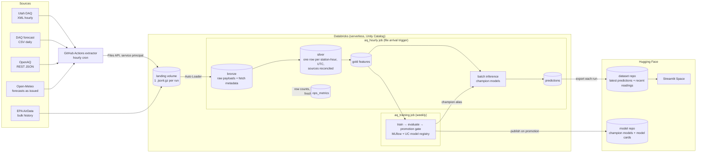

# Design: Wasatch Front PM2.5 forecasting

Status: **draft**. Sections marked *(open)* are still being decided. This document follows the shape of a systems design discussion: requirements first, then estimates, then the design and its tradeoffs.

## 1. Problem

Salt Lake Valley has some of the worst short-term PM2.5 pollution in the US. In winter, temperature inversions trap emissions in the valley for days at a time. In summer, wildfire smoke drives most bad days. Residents decide whether to exercise outside, run an air purifier, or keep kids indoors, and those decisions are made a day or more ahead.

**Goal:** for a user's zip code, show recent air quality and a PM2.5 forecast for 24, 48, and 72 hours out, from more than one model, with honest accuracy numbers next to each.

## 2. Requirements

### Functional
- A user enters a Utah zip code and sees the nearest monitoring station, its recent PM2.5 (current reading and rolling averages), and forecasts at +24h, +48h, and +72h.
- The user can choose which model produces the forecast: a persistence baseline, LightGBM, or a GRU.
- The app shows each model's measured accuracy by horizon, both on held-out test data and on live forecasts once their actual values arrive, plus how it compares to Utah DAQ's official forecast.

### Non-functional
| Requirement | Target | Why |
|---|---|---|
| Data freshness | Forecasts updated within ~1 hour of the source publishing | Sources publish hourly averages. Fresher data doesn't exist. |
| App latency | First load a few seconds, then under 1 second per lookup | The app runs in the browser and only filters precomputed predictions. The first load downloads the in-browser Python runtime, which is then cached. |
| Availability | Best effort, no cold starts | A static Space never sleeps. If the pipeline misses runs, the app shows the data's age instead of failing. |
| Cost | Under $40–50 per month in total | Paid out of pocket. Drives most of the decisions below. |
| Reproducibility | Any table can be rebuilt from bronze | Live source feeds only keep ~10 days of data. |

### Out of scope (for now)
- Areas outside Utah. Zip codes, and the DAQ feeds, are US- and Utah-specific.
- Real-time (sub-hourly) data. Kafka was considered and left out (see §9).

## 3. Scale estimates

| Quantity | Estimate |
|---|---|
| DAQ stations | 28 statewide, 17 on the Wasatch Front, plus ~39 low-cost sensors through OpenAQ |
| One DAQ pull | 3.8 MB of XML (~225 KB compressed): all stations × ~10 days of hourly history |
| Bronze growth | 24 pulls/day × ~225 KB ≈ **2 GB/year** compressed. ~99.6% of each pull overlaps the previous one. |
| Silver / gold rows | ~250k station-hours per year. A few hundred MB at most. |
| Training set | 2–5 years of station-hours: low millions of rows. Fits in memory on one node. |
| Predictions | 28 stations × 3 models × 3 horizons = 252 rows/hour ≈ 2.2M rows/year |
| App traffic | Tens of lookups per day |

**Conclusion:** this is a small-data problem. Distributed compute is not what limits it. Correctness (time zones, duplicates, late data, leakage) and cost per run are. Storing every raw pull, overlap included, costs a few cents a month and keeps bronze a complete, replayable record, so it isn't worth trimming.

## 4. Data sources

| Source | Access | Cadence | Contents | Role |
|---|---|---|---|---|
| **Utah DAQ** | REST: XML (all stations in one call), CSV per station. No key. | Hourly | PM2.5, PM10, ozone, NO₂, NOx, CO, SO₂, temperature, humidity, wind, pressure | Main live source of pollutant readings |
| **Utah DAQ forecast** | CSV. No key. | Daily | Per county, 3 days out: severity category + burn-restriction action | Official forecast to compare against |
| **OpenAQ v3** | REST, JSON. Free API key. | Hourly | PM2.5 and other pollutants from DAQ (via AirNow) plus other networks | Station coordinates and more stations. Overlaps with DAQ. |
| **Open-Meteo** | REST, JSON. No key. | Hourly | Weather forecasts, including boundary layer height. The Previous Runs API returns forecasts *as issued* 1–7 days ahead, from early 2024 (surface variables only). | Weather features for the forecast window |
| **EPA AirData** | Bulk historical files | Twice a year (June, December) | Quality-assured hourly history, every collocated instrument | Quality check on the training labels (backfill) |
| **OpenAQ history** | REST, JSON. Free API key. | One-time backfill | AirNow history for the DAQ monitors (primary instrument) | Training history for PM2.5 and NO₂ |

### What probing the DAQ feeds showed (2026-11-03)
- `xmlFeed.php` with no `id` returns all 28 sites, with about 10 days of hourly history each. Every hourly pull overlaps the previous ~240 hours.
- Missing values are `-9999` in the CSV and empty tags in the XML.
- Timestamps have no time zone. There is no repeated 01:00 on 2026-11-01, the day DST ended, which suggests **Mountain Standard Time year-round** (UTC-7), the EPA convention. *To verify across the March DST change.*
- The XML has site names but **no coordinates**. Coordinates come from OpenAQ or EPA site metadata, matched to DAQ site names through a station mapping table.
- The CSV's file name says CSV, but the content is tab-separated.
- The forecast is **categorical** (`good`, `moderate`, …, with an action such as `unrestricted`). Comparisons with it are therefore by AQI category, not PM2.5 value.
- **A DAQ timestamp marks the start of the hour.** Hawthorne's 07:00 reading matches OpenAQ's 14:00–15:00 UTC period, which is 07:00–08:00 MST.

### Matching stations across sources (2026-11-04)
- The DAQ XML names sites inconsistently: by county ("Salt Lake County" is Hawthorne, "Weber County" is Harrisville), by site, or by code ("ZZ" is the Prison Site). Each DAQ site was matched to an OpenAQ location by comparing 48 hours of PM2.5. Every match agreed within ~0.05 µg/m³ on average, against >1 µg/m³ for the next-closest candidate. The result is `reference/stations.csv`: 28 monitors, 17 of them on the Wasatch Front.
- The same monitor reads slightly differently in each source (e.g. 13.6 vs 13.5), so values from different sources are never assumed equal. Source priority decides which one silver keeps.
- Some OpenAQ locations have several PM2.5 sensors, and not all of them report. Utah Tech Center's first sensor has no data. The station table records which sensor to read, not just the location.
- **OpenAQ's main contribution is low-cost sensors.** In Utah it has 28 AirNow monitors (the same ones DAQ publishes) plus ~39 active AirGradient and Clarity sensors. Bronze pulls only the low-cost sensors from OpenAQ, and the monitors directly from DAQ.
- OpenAQ's `/parameters/{id}/latest` endpoint ignores `bbox` and returns every location worldwide. Bronze uses per-sensor `/hours` calls instead (~40 per run, under the 60/minute limit).

### Open-Meteo archive coverage (2026-11-04)
- The Previous Runs API archives **surface variables only**: temperature, humidity, dew point, wind, pressure, precipitation, cloud cover, and solar radiation, 1–7 days ahead, from early 2024. It has no data for January 2024.
- **Boundary layer height, upper-air temperatures, and temperatures at fixed heights above the ground are not archived.** Training on them would mean training on data that isn't available for past forecasts, so they can't be training features. Bronze pulls boundary layer height anyway, building our own archive of it from 2026-11-04 on.
- **Inversion proxy:** valley temperature minus ridge-top temperature, from the forecast for a point on Hidden Peak (Snowbird, ~3,350 m). During an inversion the ridge is *warmer* than the valley, so the difference changes sign. It needs only surface temperature, which is archived.
- Both the live pull and the archive request `models=gfs_seamless` explicitly. The default ("best match") can change which weather model it uses, which would make training and serving data inconsistent.
- **Units differ by source:** DAQ reports temperature in °F and ozone, NO₂, NOx, and CO in ppm. Open-Meteo reports °C. Silver converts everything to one set of units, and the unit is part of each column's name (e.g. `temp_c`).
- **Units also differ by site within the DAQ feed** (2026-11-04). Profiling each site's medians showed:
  - Washakie reports NO₂ and NOx in ppb, not ppm. Read as ppm, its values were ~1,000× too high.
  - Magna reports SO₂ in ppb.
  - Redwash and Ouray report pressure in hPa. The other sites report mmHg.
  - Washakie's temperature is a constant 0, a placeholder.

  These are recorded, with the evidence for each, in `reference/daq_unit_overrides.csv`, which silver applies before converting. A range check alone wouldn't have caught all of them: Washakie's NO₂ read as ppm (350 ppb median) is still "possible". Comparing sites against each other is what exposed it. After the fix, pressure agrees across sites (Herriman 845 hPa from mmHg vs Redwash 831 hPa native).
- **Temperature is °F** (within 0.5° of Open-Meteo after conversion). **Wind speed is assumed to be mph,** but that's inferred, not confirmed: DAQ ÷ Open-Meteo km/h has a median of 0.42. That falls between m/s (0.28) and mph (0.62). Station anemometers usually read lower than model winds at 10 m, which points to mph. *Open: confirm with DAQ.*
- One-off garbage values exist (relative humidity −2678). After conversion, values outside a plausible range become NULL and are counted as `out_of_range_<column>` in `ops_metrics`.

## 5. Architecture

### Why extraction runs outside Databricks

The first version pulled the APIs from a Databricks notebook. On this workspace, **serverless compute can only resolve an allowlist of domains:** `api.open-meteo.com`, `pypi.org`, `github.com`, and `huggingface.co` resolve, but `air.utah.gov`, `api.openaq.org`, `www.epa.gov`, and even `www.google.com` fail. A diagnostic run on 2026-11-04 showed that serverless uses its own local DNS resolver (`127.0.0.53`) and filters by the name being looked up: the AWS load balancer behind `air.utah.gov` resolved under its own hostname. DNS-over-HTTPS was blocked too. The free trial docs list "limited external network access". Upgrading the account to pay-as-you-go didn't lift it, and network policies, which would control it, require the Enterprise tier.

Extraction therefore runs in **GitHub Actions** and lands raw files in a Unity Catalog volume. This is the docs' own recommendation for blocked data ("download, then upload to your workspace"), automated:
- **Extractor** (`extractor/extract.py`): standard-library Python, ~10 seconds per run. It writes **one gzipped JSON Lines file per run**, one line per HTTP request, failures included, with the same fields as `bronze_raw`. One file per run keeps the number of files low and each upload atomic.
- **Least-privilege credentials:** the extractor authenticates as the `aq-extractor` service principal (OAuth machine-to-machine). It can read and write the landing volume and nothing else, with no access to any table.
- **Auto Loader** loads new files into `bronze_raw`, with a declared schema. Anything that doesn't fit lands in `_rescued_data`, which is counted per run.
- **File arrival trigger:** the Databricks job starts when a file lands, so the two systems don't need clocks kept in sync. A late GitHub run simply means a late Databricks run.

This also moves the time spent waiting on HTTP from billed serverless compute to a free runner. If serverless network access opens up later, extraction could move back, and nothing downstream of `bronze_raw` would change.

### Code path vs model path

The code and the models are deployed separately:
- **Code** lives in GitHub. `databricks bundle deploy` uploads the notebooks and job definitions, and a GitHub Action pushes the app code to the Hugging Face Space. The extractor runs straight from the repo in GitHub Actions.
- **Models** are produced by the weekly training job and go straight from the Unity Catalog registry to the Hugging Face model repo. They never pass through GitHub.

## 6. Data model

All tables live in `<catalog>.aq` (prod) or `<catalog>.aq_dev` (dev). Timestamps are UTC.

| Table | Grain (one row per…) | Key | Write pattern | Notes |
|---|---|---|---|---|
| `bronze_raw` | API call or loaded file | `(source, fetched_at)` | Append (Auto Loader, idempotent per batch) | `source`, `request`, `fetched_at`, `http_status`, `body` (raw text), `error`, `latency_ms`, `run_id`, `source_file`, `ingested_at`. Never updated. |
| `silver_station` | Station | `station_id` | Overwrite from `reference/stations.csv` | DAQ site name, OpenAQ location and PM2.5 sensor IDs, latitude/longitude, county, DAQ forecast area, Wasatch Front flag. Maps the sources' different station IDs to one ID. Reference data kept in git. |
| `silver_readings` | Station × hour × source | `(station_id, hour_utc, source)` | MERGE, update when newer and values differ | Parsed, units converted per site, `-9999` and out-of-range → NULL. `revisions` counts how often the source changed a value it had already published. |
| `silver_readings_best` | Station × hour | `(station_id, hour_utc)` | MERGE (written by the gold task) | One PM2.5 and NO₂ series per station: AirNow history first, DAQ after it. `pm25_source` says which. `pm25_qa_removed` marks hours that EPA's quality review invalidated (§8). |
| `silver_weather_forecast` | Station × issue hour × target hour | `(station_id, issued_hour_utc, target_hour_utc)` | MERGE | Open-Meteo forecast for `target_hour` fetched at `issued_hour`, plus `lead_hours`. Matched to stations by position in the request, since the response snaps coordinates to the model grid. |
| `silver_daq_forecast` | Forecast area × day × issue date | `(daq_forecast_area, forecast_date, issued_date)` | MERGE | DAQ's official category and action, with `days_ahead`. |
| `silver_lowcost_sensors` | Low-cost PM2.5 sensor | `sensor_id` | MERGE | AirGradient / Clarity sensors from OpenAQ: location, provider, coordinates, last report. |
| `silver_lowcost_readings` | Sensor × hour | `(sensor_id, hour_utc)` | MERGE | PM2.5, coverage %, OpenAQ flags. Kept apart from `silver_readings`, because these aren't regulatory monitors: gold uses them as neighborhood context, not as forecast targets. |
| `gold_features` | Station × hour | `(station_id, hour_utc TIMESERIES)` primary key | MERGE over a 14-day recompute window; `full` mode rebuilds | Unity Catalog feature table. Features known once `hour_utc`'s reading is in, plus labels `pm25_t24/48/72`, which fill in as those hours arrive. See §10. |
| `predictions` | Station × as-of hour × model × horizon | `(station_id, hour_utc, model, horizon_h)` | MERGE (a rerun replaces a forecast only if the model version or value changed) | `model_version`, `predicted_pm25`, `target_hour_utc`, `input_age_h`, `scored_at`. Each run scores every station's newest hour with each `@champion` and persistence. Joined later with readings for live accuracy. |
| `ops_metrics` | Run × check | `(run_id, task, source, metric)` | Append | Row counts, NULL rates, out-of-range counts, freshness. See §12. |

Clustering: the tables are small enough that partitioning would only create many tiny files. Instead, the larger tables use liquid clustering on `(station_id, hour_utc)`, and predictive optimization compacts the small files left by hourly writes.

## 7. Interfaces

| Consumer | Reads | Format |
|---|---|---|
| Streamlit Space | `latest/` in the HF dataset repo: `forecasts.csv` (every station × model × horizon), `history.csv` (last 7 days of PM2.5), `accuracy.csv` (live MAE over 7 and 30 days), `stations.csv`, `daq_forecast.csv`, and `meta.json` (`as_of`, champion versions) | CSV, overwritten as one commit each run (the dataset repo's git history keeps old versions). CSV rather than Parquet: the app runs in the browser, where reading Parquet means loading pyarrow into WebAssembly, and these files are a few hundred KB at most. |
| Streamlit Space | Utah zip code centroids (Census ZCTA Gazetteer 2024, 298 zips) | `space/utah_zips.csv`, shipped with the app |
| Anyone | Champion models + model cards (metrics by horizon and season) | HF model repo |

The Space is a **static** Space that runs Streamlit in the visitor's browser through [stlite](https://github.com/whitphx/stlite) (Python compiled to WebAssembly). Because the browser downloads the data directly, the dataset repo is **public**. It holds only forecasts made from public data, and no token is ever sent to the browser. All data loading goes through one function, so the same `app.py` also runs as a normal server-side Streamlit app (`streamlit run` locally, or a Docker Space later).

The app finds the nearest station to the zip code's centroid. If that station is more than a set distance away, the app says so instead of showing a misleading forecast.

## 8. Backfill

`extractor/backfill.py` runs once, from a laptop, because serverless can't reach these sources either (§5). Each step saves its files under `data/backfill/` before uploading, so an interrupted run resumes where it stopped. Training starts **2024-01-22**, when Open-Meteo's archive of forecasts issued 3 days ahead begins. The backfill starts a week earlier, so rolling features have history on the first training day.

| Step | Source | Window | Volume | Lands in |
|---|---|---|---|---|
| `openaq` | OpenAQ `/sensors/{id}/hours`: PM2.5 + NO₂ sensors of every DAQ monitor (53 sensors) | 2024-01-15 → backfill date | ~1,400 requests, ~1 GB raw JSON | `landing/raw/backfill/openaq_history/` → `bronze_raw` |
| `openmeteo` | Open-Meteo Previous Runs: 8 surface variables at lead 0–3 days, every station + ridge point | 2024-01-15 → backfill date | 29 × 12 quarterly requests | `landing/raw/backfill/openmeteo_archive/` → `bronze_raw` |
| `epa` | EPA AirData pre-generated hourly files, PM2.5 (88101) + NO₂ (42602), Utah rows only | 2024-01-01 → 2026-06-01 | 6 national zips, ~65 MB each | `landing/epa/` → `bronze_epa_hourly` |

### What the backfill turned up (2026-11-04)
- **EPA's quality-assured files lag by months.** They're regenerated twice a year (June and December). On 2026-11-04 the 2026 files ended at **2026-06-01**, and DAQ's live feed only reaches back to 2026-10-20. Neither covers June–October 2026, which is wildfire smoke season.
- **OpenAQ keeps AirNow's history for the same monitors,** and it fills that gap. For Hawthorne in January 2026, it matched EPA's POC 2 *exactly* (average difference 0.00 over 347 hours), while the second instrument at the site (POC 4) differed by ~1.5 µg/m³. So AirNow publishes the site's primary instrument. EPA's data was missing 12 of AirNow's 359 hours (~3%), presumably invalidated in quality review.
- **Sites have several collocated instruments (POCs).** EPA reports each one. Hawthorne, Smithfield, Roosevelt, Herriman, and Moab each have two, and Moab's two use different methods.
- **Non-reference PM2.5 (parameter 88502) has no Utah data.** Every Utah PM2.5 monitor reports under 88101.
- **NO₂ units differ by source again:** OpenAQ reports ppm, EPA ppb. Silver converts both to ppb.
- **Station IDs don't line up across systems.** EPA site IDs were matched to stations by coordinates, one to one. Most matches are within 0.6 km, but Rose Park is 1.25 km away. The match is one to one, but the two systems' coordinates for the site differ.
- **The APIs are slow, not just rate-limited.** OpenAQ takes ~6 seconds to answer each 40-day request, so the history download runs as 5 parallel shards. Open-Meteo counts large requests as several calls against its free limits, so that step runs one request at a time and waits it out when it gets a 429.

### Decision: AirNow history is the training series, and EPA is a check on it
- **Train on what you serve.** Live forecasts are scored against DAQ's feed, which is the AirNow primary-instrument series. Training labels from the same series keep training and serving consistent. EPA's quality-assured data would mean switching series on 2026-06-01, with a choice of instrument at five sites.
- **EPA tells us which hours quality review removed or changed.** Gold can drop those hours from the labels where EPA covers them. `silver_epa_readings` keeps every POC with its qualifiers, so this can be measured rather than assumed.

### Checking the decision against the data (2026-11-04)
| Comparison | Overlap | Result |
|---|---|---|
| AirNow vs EPA, PM2.5 | 2024-01-15 → 2026-06-01, 24 stations | AirNow matches one EPA instrument **exactly 96–100% of the time** at every station. Quality review removed **0–3.3%** of AirNow's hours (most at Enoch, 3.3%, and Lindon, 2.4%). |
| AirNow vs DAQ live, NO₂ | Since 2026-10-20 | Only 10% exact, but the average difference is 0.25 ppb: exactly the average error from rounding to whole numbers. DAQ reports ppm to 3 decimals, which is 1 ppb resolution. |
| AirNow vs DAQ live, PM2.5, 19 stations | Since 2026-10-20 | Average difference 0.05, with DAQ consistently 0.05 higher. That's half of one 0.1 step, so the two sources round differently. |
| AirNow vs DAQ live, PM2.5, 7 stations | Since 2026-10-20 | Prison Site, Erda, Bountiful, Brigham City, Smithfield, Lake Park, and Magna, the stations whose DAQ feed goes back 15 days rather than 10. Hours less than 7 days old agree (average difference ~0.05). **Older hours read 0.3–0.9 µg/m³ lower in DAQ than in AirNow,** which still holds the values as first published. A shift of ±1 hour makes the agreement far worse, so this isn't a time offset. |

The likely explanation is that **DAQ revises some stations' values downward after about a week** in its live feed, perhaps applying a correction for one instrument type. Silver's `revisions` counter will confirm or rule this out over the coming weeks: revisions should cluster at those 7 stations, on hours around 7 days old. *Open.*

None of this weakens the decision. Fresh DAQ values (served) match AirNow (trained on), and AirNow matches EPA's quality-assured data. Only DAQ's later revisions differ, and the training labels don't use those.

### Reference data changes need a replay
The first EPA load dropped ~67,000 rows. The station mapping had been built from EPA's 2026 file, so Redwash and Ouray (no 2026 EPA data yet) and two tribal NO₂ sites had no station. Fixing `stations.csv` doesn't reprocess those rows: the silver stream's checkpoint has already moved past them. The fix is to delete that one stream's checkpoint and rerun. Every silver write is a MERGE, so the replay matches the rows already loaded instead of duplicating them. The two tribal sites aren't in DAQ's feed and stay out of scope.

### Rebuilding
Silver and gold can be rebuilt from bronze at any time. Every write is a MERGE on the table's key, so re-running any date range gives the same result and never duplicates rows.

## 9. Key decisions

| Decision | Chosen | Rejected | Reasoning |
|---|---|---|---|
| Where extraction runs | GitHub Actions → landing volume → Auto Loader | Databricks notebook calling the APIs; classic compute | Serverless can't reach most source domains on this workspace (§5). Classic compute would likely have open internet access, but would spend 3–5 minutes starting a cluster every hour. GitHub Actions is free and keeps Databricks runs short. |
| Ingestion transport | REST pull → bronze | Kafka | Sources are hourly REST APIs with one consumer. Kafka helps with many producers, high event rates, or several consumers needing decoupling and replay. None apply, and a managed cluster costs money. |
| Webhooks | Not used | | No source pushes events. Adding webhooks would mean hosting a public endpoint for no benefit. |
| Inference | **Batch**, hourly in Databricks | Online, in the Space | Each zip maps to one of ~28 stations, so every possible request is known ahead of time: 252 predictions per hour cover them all. The Space needs no ML libraries, and every forecast served is stored, which gives live monitoring for free. |
| Serving | Exported predictions on Hugging Face | Databricks Model Serving, online feature store, querying a SQL warehouse per request | These bill continuously or per request. Traffic is tens of requests per day, and the data changes hourly. |
| App hosting | Static HF Space, Streamlit in the browser (stlite) | Docker Space (needs HF PRO, ~$9/month), Gradio on ZeroGPU | Free, and never sleeps, so no 30–60 s wake-up for occasional visitors. It only works because inference is batch: the app reads a file and draws charts, with no model to run. Moving to Docker later replaces only the packaging, not the app code. |
| Processing engine | Spark (on the platform it runs on) | DuckDB / Polars + cron | At this volume Spark is neither the bottleneck nor the reason for choosing it. It's the platform's engine and handles the backfill well. Standalone, DuckDB or Polars would be simpler. API calls and model training run as plain Python on one node, not as Spark jobs. |
| Region | Ingest statewide, app focused on the Wasatch Front | Salt Lake Valley only | One DAQ call returns every station, so statewide ingestion costs nothing extra. Training on more stations helps the models generalize. |
| Horizons | 24 / 48 / 72h | 1h | At 1h, PM2.5 barely changes, and persistence is nearly impossible to beat. Multi-day horizons are what residents plan around, and they show where models stop adding value. |
| Weather features | Forecasts *as issued* (Open-Meteo Previous Runs) | Observed weather | In production, only forecast weather exists for the next 72 hours. Training on observed weather leaks information the model won't have and makes accuracy look better than it is (training/serving skew). |
| Retraining | Weekly, with a promotion gate | Retrain only manually; promote every new model | A schedule keeps the model current without manual work. The gate stops a bad week of data from silently replacing a better model. |
| Feature store | Delta table with a `(station_id, hour_utc TIMESERIES)` primary key (Unity Catalog feature table) | Online feature store; features computed separately in training and serving code | Batch inference reads the same table training does, so there's no online lookup to pay for, and one definition of each feature prevents training/serving skew. The timeseries key supports point-in-time joins if other tables' features are added later. |
| Compute | Serverless jobs, standard performance mode | All-purpose clusters; performance-optimized serverless | Each run takes minutes. Serverless bills only for those minutes and has no idle cluster to forget about. Standard mode costs less per run and only starts slower, which a batch job doesn't notice. |
| Pipeline cadence | Extract hourly, process at most every ~3 hours | Process every hour | Measured at ~$0.13 per run, hourly processing would cost ~$90 a month, about twice the budget. Forecasts are 24–72 h ahead, so inputs a few hours old barely change them. Extraction stays hourly, because it's free and keeps every hour's issued forecast for the weather features. |

## 10. Gold features

One row per PM2.5 station per hour, 26 stations, ~635k rows from 2024-01-22. A row holds what is known once the reading for `hour_utc` has arrived. The same table feeds training and hourly inference, so a feature is defined once.

| Group | Columns | Notes |
|---|---|---|
| Readings | `pm25_ugm3`, lags 1–72 h, means over 3 h–7 days, 24 h max/std/count, 24 h change, NO₂ 24 h mean | A complete hour grid per station, so `lag(n)` is exactly *n* hours even across gaps. |
| Region | Wasatch Front mean PM2.5 now and over 24 h | An inversion traps the whole valley at once. |
| Calendar | Hour, weekday, day of year in fixed MST; `fireworks_t*` for the target day | Fireworks nights (July 4, Pioneer Day on July 24, New Year) cause the sharpest summer spikes. |
| Weather, per horizon | `wx24_*`, `wx48_*`, `wx72_*`: forecast at the target hour, plus 24 h wind, precipitation, inversion, and pressure change ending there | Forecasts as issued ~1/2/3 days ahead: archive `lead_days` for history, the live forecast issued ≥ 24·d h earlier since extraction started. |
| Labels | `pm25_t24`, `pm25_t48`, `pm25_t72` | NULL where EPA's review removed the hour. Features keep those hours, because serving sees unreviewed data too. |

**Inversion proxy.** The archive has no boundary layer height, so `inversion_c` is the Hidden Peak ridge temperature minus the station's temperature. It carries real signal. In winter on the Wasatch Front, mean PM2.5 the next day goes from **4.6 µg/m³** when the forecast shows the air well mixed (ridge more than 12 °C colder) to **20.7 µg/m³** under a strong inversion (gap under 4 °C).

**Left out on purpose:**
- **Low-cost sensors** and **DAQ's official forecast** only exist since live extraction started (2026-11). Columns that are NULL across the whole training history teach the model nothing, and then behave differently at serving time. DAQ's forecast is the benchmark in evaluation instead (§11). Low-cost sensors come back once there's a season of history, or through an OpenAQ backfill of those sensors.
- **Observed station weather** from DAQ (temperature, wind) has the same problem, and observed weather for the target hour would be leakage anyway (§9).

**Checks run on the first build (2026-11-05):**
- Time alignment: across 533k rows, every `pm25_t24` and `pm25_t72` equals the reading exactly 24 and 72 hours later, and every `pm25_lag_24h` the reading 24 hours earlier. **0 mismatches.**
- Rerunning `full` updated 0 rows of `silver_readings_best`, even though the EPA files reloaded into bronze. That confirms the MERGEs are idempotent.
- Weather coverage is 99.4–99.6% per horizon. PM2.5 coverage is 85% overall, because six monitors started reporting during the window (Washakie and Magna in 2026, for example). Established stations are 97–99% complete.

**Persistence baseline (Wasatch Front, MAE in µg/m³),** the number every model has to beat:

| Season | 24 h | 48 h | 72 h |
|---|---|---|---|
| Winter (Dec–Feb) | 4.18 | 5.42 | 6.26 |
| Summer (Jul–Sep) | 4.05 | 4.60 | 4.78 |
| Other | 3.27 | 3.75 | 3.96 |

Persistence gets worse fastest in winter, when inversions build and break over days. That's where forecast weather should help most.

## 11. Models and training

- **Baselines:** persistence (forecast = latest value) and the trailing 24-hour mean. Same-hour-yesterday is persistence at 24 h, and undefined at 48 and 72 h.
- **LightGBM:** one model per horizon on the gold features.
- **GRU (PyTorch, trained from scratch):** one network with three outputs (one per horizon). Input is the last 24–72 hours of readings plus forecast weather.
- **Stretch goal:** a zero-shot time-series foundation model (e.g. Chronos) as a fourth option.

### Backtest (2026-11-05)
Trained on 2024-01-22 → 2025-10-28, tested on 2025-11-01 → 2026-10-31: one full winter and summer the models never saw. Run on a laptop from the gold snapshot (`training/backtest.py`). MAE in µg/m³, all 26 stations:

| Model | 24 h | 48 h | 72 h | Winter 24 / 72 h | Summer 24 / 72 h | Train time (M1 Pro) |
|---|---|---|---|---|---|---|
| Persistence | 3.30 | 3.80 | 4.07 | 3.63 / 5.20 | 4.19 / 4.89 | |
| Trailing 24 h mean | 3.25 | 3.62 | 3.82 | 3.84 / 5.06 | 4.02 / 4.65 | |
| **LightGBM** (Tweedie) | **2.50** | **2.66** | 2.80 | **2.66** / 3.19 | 3.41 / 3.74 | 2.7 min |
| **GRU** (from scratch) | 2.57 | 2.67 | **2.78** | 2.80 / **3.05** | **3.36** / **3.70** | 1.5 min (MPS) |

- **Both models beat persistence by 24–32%, and the gap widens with the horizon.** In winter at 72 h they cut the error by 39–41%, which is where forecast weather matters most.
- **Inversion and pressure-change forecasts rank among LightGBM's top features,** after recent PM2.5, station, and season. That confirms the valley-minus-ridge proxy (§10) carries signal.
- **The two models are roughly tied, with different strengths.** LightGBM is better at short range, the GRU at 72 h and in summer. The app shows both.
- **Objective:** Tweedie beat squared error at every horizon and brought bias near zero. Huber was similar overall but worse in winter.
- **Neither model forecasts spikes.** On hours ≥ 35.5 µg/m³ (unhealthy for sensitive groups, 696 hours in the test year), every model, persistence included, is off by 30–35, almost all of it underprediction. No objective changed that. Fireworks smoke and plumes from distant wildfires aren't visible in these features. A smoke signal (e.g. NOAA HMS smoke polygons, or a satellite aerosol product) is the obvious next feature. *Open.*
- **The GRU's validation MAE peaked at epoch 2.** A 28-day validation window is small and seasonally narrow, so early stopping is noisy. *Open: a longer or season-matched validation window.*

**Local caveat:** on macOS, LightGBM and PyTorch each load their own OpenMP runtime, and PyTorch CPU ops segfault with both loaded. The backtest trains one model per process for that reason. Linux isn't affected.

### Weekly training and promotion
1. Read `gold_features` into pandas. A few million rows fits in memory.
2. Split by time: train on everything before the last *N* weeks, test on those *N* weeks. Never split randomly, because that leaks future information into training.
3. Train, and log parameters, metrics, and the model to MLflow. Register a new version in Unity Catalog.
4. **Promotion gate:** the new version gets the `champion` alias only if it beats both the current champion and the persistence baseline on the same test window (MAE, per horizon). Otherwise the current champion stays.
5. On promotion, publish the model and an updated model card to the HF model repo.

Batch inference always loads `models:/<name>@champion`, so a promotion takes effect on the next hourly run without any code change.

### Evaluation
- MAE and RMSE for each horizon.
- Reported for winter (inversion) and summer (smoke) separately, because they are different problems.
- Accuracy by AQI category, compared with the DAQ forecast.
- **Live accuracy:** `predictions` joined with actual readings once the target hour has passed.

### Training data caveats *(open)*
- Labels are the AirNow series as first published, minus the hours EPA's quality review removed. After the backfill date, labels come from DAQ's live feed, which revises some stations' values after about a week (§8). The 14-day gold recompute window picks those revisions up, so a label can change after a model was trained on it.
- EPA's review lags by months, so the last ~5 months of labels haven't been quality-checked. In the checked period review removed 0–3.3% of hours, which bounds how much this matters.
- One week adds ~0.5% to the history, so each retrain changes the model very little. Monthly retraining would work too, and would cost less.

## 12. Monitoring

Each task writes its checks to `ops_metrics`, so they can be queried over time instead of searched for in logs.

| Kind | Examples | Action |
|---|---|---|
| **Hard checks** | Zero rows parsed from DAQ. Newest DAQ hour more than 3 hours old. Predictions missing for any station. | Notebook raises an error → job fails → failure email (already configured). |
| **Soft checks** | NULL share per field. Out-of-range values. A field's average far from its trailing 30-day value. Fields present in the payload that the parser doesn't know about. | Recorded in `ops_metrics`. Shown on a small dashboard. |
| **Model** | Live MAE by model and horizon over the last 7 and 30 days. | Shown in the app and on the dashboard. |
| **Pipeline and cost** | Run duration, failures, DBUs per run. | Read from Databricks system tables (`system.lakeflow`, `system.billing.usage`). |

No Databricks SQL alerts: they need a SQL warehouse running on a schedule. Failing the job covers the urgent cases at no extra cost.

## 13. Failure modes

| Failure | Effect | Handling |
|---|---|---|
| Source API down for a run | That hour isn't fetched | The run continues with the other sources. DAQ's 10-day window means the next successful pull fills the gap. Each request retries 3 times with backoff. |
| GitHub scheduled run late or skipped | Data arrives late | Common when GitHub is busy. Overlapping source windows fill the gap on the next run. The bronze freshness check fails the job if no DAQ pull has succeeded for 3 hours. |
| Extractor fails (bad credential, DAQ down) | No new file | Workflow exits non-zero after uploading what it got, and GitHub emails the failure. |
| Service principal secret expires | Every upload fails | Secret lifetime is 1 year, with a rotation reminder. The failures surface through both GitHub's email and the freshness check. |
| Reference mapping fixed after data was loaded | Rows that didn't map earlier stay missing | Reset that silver stream's checkpoint and rerun. MERGE makes the replay idempotent. `ops_metrics` row counts (`bronze_rows` vs `rows`) show when a join is dropping rows. |
| Bronze batch retried after a partial failure | Duplicate bronze rows | Delta `txnAppId` / `txnVersion` makes each micro-batch write idempotent. |
| Duplicate and overlapping rows | Hours counted twice | MERGE on (station, hour) in silver. |
| Late corrections to a reading | Silver holds an outdated value | MERGE updates the row when the newer fetch differs. |
| Sensor reports -9999 or an impossible value | Bad features | NULL in silver, range checks, NULL share recorded in `ops_metrics`. |
| DST change | Duplicate or missing hours if parsed as local wall-clock time | Parse DAQ time as fixed UTC-7, never as `America/Denver`. |
| Field renamed or removed in a source | Field is all NULL | Bronze keeps the raw body, so nothing is lost. NULL share for that field jumps to ~100%. Fix the parser and rebuild silver from bronze. |
| Whole payload structure changes | Nothing parses | Parsed row count = 0 is a hard check, so the job fails. |
| A source changes units (e.g. °F → °C) | Values look valid but are wrong | Not caught by NULL checks. Caught by range checks and the comparison with trailing averages. |
| Hourly forecasts missing (extractor late or stopped) | Weather features for new rows | Gold uses the newest forecast issued at least *d* days ahead, up to 23 hours older, so a few missed runs leave the features slightly stale rather than missing. Beyond that they're NULL, and `share_with_weather_t*` in `ops_metrics` drops. |
| New feature added to gold | Old rows lack the column | `MERGE WITH SCHEMA EVOLUTION` adds the column; a `gold_mode=full` run fills it in for every past row. |
| New model is worse | Worse forecasts | Promotion gate keeps the current champion. |
| Job misses hours | App shows stale data | The exported file carries an `as_of` timestamp, and the app shows its age. |
| Cost overrun | Bill exceeds budget | Budget alert on the account. Cost per run measured from `system.billing.usage`. Already applied once: see the cost findings below. |

### Cost findings (2026-11-05)
Measured from `system.billing.usage` × `system.billing.list_prices` after the first three days of building:

| Item | Cost | Lesson |
|---|---|---|
| SQL warehouse (Serverless Starter, Small, 10-minute auto-stop) | **$20.71**, ~75% of the total | Ad-hoc checking queries cost more than every pipeline run together. Each query kept a Small warehouse up for 10+ minutes. **Fix:** 2X-Small (¼ the DBUs per hour) and a 1-minute auto-stop, and checks run against the local gold snapshot instead. |
| Pipeline job, 10 runs (backfill and full rebuilds) | $1.27 (~$0.13 per run) | At one run per hour that's ~$90 a month. **Fix:** standard performance mode, and at most one run per ~3 hours. |
| Interactive serverless (notebooks in the UI) | $2.89 | |

The biggest cost wasn't the pipeline or the models. It was an always-warm interactive warehouse. The budget alert didn't catch it, because the total was still under $50. Billing tables only show it with a few hours' delay.
