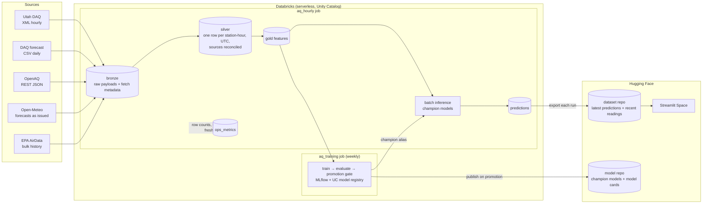

# Design: Wasatch Front PM2.5 forecasting

Status: **draft**. Sections marked *(open)* are still being decided. This document follows the shape of a systems design discussion: requirements first, then estimates, then the design and its tradeoffs.

## 1. Problem

Salt Lake Valley has some of the worst short-term PM2.5 pollution in the US. In winter, temperature inversions trap emissions in the valley for days at a time. In summer, wildfire smoke drives most bad days. Residents decide whether to exercise outside, run an air purifier, or keep kids indoors, and those decisions are made a day or more ahead.

**Goal:** for a user's zip code, show recent air quality and a PM2.5 forecast for 24, 48, and 72 hours out, from more than one model, with honest accuracy numbers next to each.

## 2. Requirements

### Functional
- A user enters a Utah zip code and sees the nearest monitoring station, its recent PM2.5 (current reading and rolling averages), and forecasts at +24h, +48h, and +72h.
- The user can choose which model produces the forecast: a persistence baseline, LightGBM, or a GRU.
- The app shows each model's measured accuracy by horizon, both on held-out test data and on live forecasts once their actual values arrive, plus how it compares to Utah DAQ's official forecast.

### Non-functional
| Requirement | Target | Why |
|---|---|---|
| Data freshness | Forecasts updated within ~1 hour of the source publishing | Sources publish hourly averages. Fresher data doesn't exist. |
| App latency | First load a few seconds, then under 1 second per lookup | The app runs in the browser and only filters precomputed predictions. The first load downloads the in-browser Python runtime, which is then cached. |
| Availability | Best effort, no cold starts | A static Space never sleeps. If the pipeline misses runs, the app shows the data's age instead of failing. |
| Cost | Under $40–50 per month in total | Paid out of pocket. Drives most of the decisions below. |
| Reproducibility | Any table can be rebuilt from bronze | Live source feeds only keep ~10 days of data. |

### Out of scope (for now)
- Areas outside Utah. Zip codes, and the DAQ feeds, are US- and Utah-specific.
- Real-time (sub-hourly) data. Kafka was considered and left out (see §9).

## 3. Scale estimates

| Quantity | Estimate |
|---|---|
| DAQ stations | 28 statewide, 17 on the Wasatch Front, plus ~39 low-cost sensors through OpenAQ |
| One DAQ pull | 3.8 MB of XML (~225 KB compressed): all stations × ~10 days of hourly history |
| Bronze growth | 24 pulls/day × ~225 KB ≈ **2 GB/year** compressed. ~99.6% of each pull overlaps the previous one. |
| Silver / gold rows | ~250k station-hours per year. A few hundred MB at most. |
| Training set | 2–5 years of station-hours: low millions of rows. Fits in memory on one node. |
| Predictions | 28 stations × 3 models × 3 horizons = 252 rows/hour ≈ 2.2M rows/year |
| App traffic | Tens of lookups per day |

**Conclusion:** this is a small-data problem. Distributed compute is not what limits it. Correctness (time zones, duplicates, late data, leakage) and cost per run are. Storing every raw pull, overlap included, costs a few cents a month and keeps bronze a complete, replayable record, so it isn't worth trimming.

## 4. Data sources

| Source | Access | Cadence | Contents | Role |
|---|---|---|---|---|
| **Utah DAQ** | REST: XML (all stations in one call), CSV per station. No key. | Hourly | PM2.5, PM10, ozone, NO₂, NOx, CO, SO₂, temperature, humidity, wind, pressure | Main live source of pollutant readings |
| **Utah DAQ forecast** | CSV. No key. | Daily | Per county, 3 days out: severity category + burn-restriction action | Official forecast to compare against |
| **OpenAQ v3** | REST, JSON. Free API key. | Hourly | PM2.5 and other pollutants from DAQ (via AirNow) plus other networks | Station coordinates and more stations. Overlaps with DAQ. |
| **Open-Meteo** | REST, JSON. No key. | Hourly | Weather forecasts, including boundary layer height. The Previous Runs API returns forecasts *as issued* 1–7 days ahead, from early 2024 (surface variables only). | Weather features for the forecast window |
| **EPA AirData** | Bulk historical files | Yearly or quarterly | Quality-assured hourly history | Labels for training (backfill) |

### What probing the DAQ feeds showed (2026-11-03)
- `xmlFeed.php` with no `id` returns all 28 sites, with about 10 days of hourly history each. Every hourly pull overlaps the previous ~240 hours.
- Missing values are `-9999` in the CSV and empty tags in the XML.
- Timestamps have no time zone. There is no repeated 01:00 on 2026-11-01, the day DST ended, which suggests **Mountain Standard Time year-round** (UTC-7), the EPA convention. *To verify across the March DST change.*
- The XML has site names but **no coordinates**. Coordinates come from OpenAQ or EPA site metadata, matched to DAQ site names through a station mapping table.
- The CSV's file name says CSV, but the content is tab-separated.
- The forecast is **categorical** (`good`, `moderate`, …, with an action such as `unrestricted`). Comparisons with it are therefore by AQI category, not PM2.5 value.
- **A DAQ timestamp marks the start of the hour.** Hawthorne's 07:00 reading matches OpenAQ's 14:00–15:00 UTC period, which is 07:00–08:00 MST.

### Matching stations across sources (2026-11-04)
- The DAQ XML names sites inconsistently: by county ("Salt Lake County" is Hawthorne, "Weber County" is Harrisville), by site, or by code ("ZZ" is the Prison Site). Each DAQ site was matched to an OpenAQ location by comparing 48 hours of PM2.5. Every match agreed within ~0.05 µg/m³ on average, against >1 µg/m³ for the next-closest candidate. The result is `reference/stations.csv`: 28 monitors, 17 of them on the Wasatch Front.
- The same monitor reads slightly differently in each source (e.g. 13.6 vs 13.5), so values from different sources are never assumed equal. Source priority decides which one silver keeps.
- Some OpenAQ locations have several PM2.5 sensors, and not all of them report. Utah Tech Center's first sensor has no data. The station table records which sensor to read, not just the location.
- **OpenAQ's main contribution is low-cost sensors.** In Utah it has 28 AirNow monitors (the same ones DAQ publishes) plus ~39 active AirGradient and Clarity sensors. Bronze pulls only the low-cost sensors from OpenAQ, and the monitors directly from DAQ.
- OpenAQ's `/parameters/{id}/latest` endpoint ignores `bbox` and returns every location worldwide. Bronze uses per-sensor `/hours` calls instead (~40 per run, under the 60/minute limit).

### Open-Meteo archive coverage (2026-11-04)
- The Previous Runs API archives **surface variables only**: temperature, humidity, dew point, wind, pressure, precipitation, cloud cover, and solar radiation, 1–7 days ahead, from early 2024. It has no data for January 2024.
- **Boundary layer height, upper-air temperatures, and temperatures at fixed heights above the ground are not archived.** Training on them would mean training on data that isn't available for past forecasts, so they can't be training features. Bronze pulls boundary layer height anyway, building our own archive of it from 2026-11-04 on.
- **Inversion proxy:** valley temperature minus ridge-top temperature, from the forecast for a point on Hidden Peak (Snowbird, ~3,350 m). During an inversion the ridge is *warmer* than the valley, so the difference changes sign. It needs only surface temperature, which is archived.
- Both the live pull and the archive request `models=gfs_seamless` explicitly. The default ("best match") can change which weather model it uses, which would make training and serving data inconsistent.
- **Units differ by source:** DAQ reports temperature in °F and ozone, NO₂, NOx, and CO in ppm. Open-Meteo reports °C. Silver converts everything to one set of units, and the unit is part of each column's name (e.g. `temp_c`).

## 5. Architecture

### Code path vs model path

The code and the models are deployed separately:
- **Code** lives in GitHub. Databricks pulls the notebooks through a Git folder. A GitHub Action pushes the app code to the Hugging Face Space.
- **Models** are produced by the weekly training job and go straight from the Unity Catalog registry to the Hugging Face model repo. They never pass through GitHub.

## 6. Data model

All tables live in `<catalog>.aq` (prod) or `<catalog>.aq_dev` (dev). Timestamps are UTC.

| Table | Grain (one row per…) | Key | Write pattern | Notes |
|---|---|---|---|---|
| `bronze_raw` | API call or loaded file | `(source, fetched_at)` | Append | `source`, `request`, `fetched_at`, `http_status`, `body` (raw text), `run_id`. Never updated. |
| `silver_station` | Station | `station_id` | MERGE | DAQ site name, OpenAQ location ID, EPA site ID, latitude/longitude, county. Maps the sources' different station IDs to one ID. |
| `silver_readings` | Station × hour × source | `(station_id, hour_utc, source)` | MERGE, update when values differ | Parsed, units converted, `-9999` → NULL. Keeps each source's values side by side. |
| `silver_readings_best` | Station × hour | `(station_id, hour_utc)` | MERGE | One value per field, picked by source priority: EPA (quality-checked) > DAQ > OpenAQ. |
| `silver_weather_forecast` | Location × target hour × lead time | `(station_id, target_hour_utc, lead_hours)` | MERGE | Open-Meteo forecast for `target_hour` as issued `lead_hours` earlier. |
| `silver_daq_forecast` | County × day | `(county, forecast_date, issued_date)` | MERGE | DAQ's official category and action. |
| `gold_features` | Station × hour | `(station_id, hour_utc)` | MERGE | Feature table (Unity Catalog feature table). Labels `pm25_t24`, `pm25_t48`, `pm25_t72` are filled in as actual values arrive. |
| `predictions` | Run × station × model × horizon | `(issued_at, station_id, model, horizon_h)` | Append | `model_version`, `predicted_pm25`, `target_hour_utc`. Joined later with actual values for live accuracy. |
| `ops_metrics` | Run × check | `(run_id, task, source, metric)` | Append | Row counts, NULL rates, out-of-range counts, freshness. See §11. |

Clustering: the tables are small enough that partitioning would only create many tiny files. Instead, the larger tables use liquid clustering on `(station_id, hour_utc)`, and predictive optimization compacts the small files left by hourly writes.

## 7. Interfaces

| Consumer | Reads | Format |
|---|---|---|
| Streamlit Space | `latest.parquet` in the HF dataset repo: for each station, the last 72 hours of PM2.5, rolling averages, the latest forecasts from each model, live accuracy, and an `as_of` timestamp | Parquet, overwritten each run (the dataset repo's git history keeps old versions) |
| Streamlit Space | Station list with coordinates, and a zip code → latitude/longitude table | Small static files shipped with the app |
| Anyone | Champion models + model cards (metrics by horizon and season) | HF model repo |

The Space is a **static** Space that runs Streamlit in the visitor's browser through [stlite](https://github.com/whitphx/stlite) (Python compiled to WebAssembly). Because the browser downloads the data directly, the dataset repo is **public**. It holds only forecasts made from public data, and no token is ever sent to the browser. All data loading goes through one function, so the same `app.py` also runs as a normal server-side Streamlit app (`streamlit run` locally, or a Docker Space later).

The app finds the nearest station to the zip code's centroid. If that station is more than a set distance away, the app says so instead of showing a misleading forecast.

## 8. Backfill

1. **History download:** EPA AirData hourly files for Utah PM2.5 and the co-pollutants, 2–5 years, saved to the `landing` volume and appended to `bronze_raw` (one row per file).
2. **Weather history:** Open-Meteo Previous Runs API for the same stations, early 2024 onward (where the archive of forecasts as issued begins). Training data is limited to this window.
3. **Rebuild:** silver and gold are rebuilt from bronze. Because every write is a MERGE on the table's key, re-running any date range gives the same result (idempotent). Rerunning never duplicates rows.

## 9. Key decisions

| Decision | Chosen | Rejected | Reasoning |
|---|---|---|---|
| Ingestion transport | REST pull → bronze | Kafka | Sources are hourly REST APIs with one consumer. Kafka helps with many producers, high event rates, or several consumers needing decoupling and replay. None apply, and a managed cluster costs money. |
| Webhooks | Not used | | No source pushes events. Adding webhooks would mean hosting a public endpoint for no benefit. |
| Inference | **Batch**, hourly in Databricks | Online, in the Space | Each zip maps to one of ~28 stations, so every possible request is known ahead of time: 252 predictions per hour cover them all. The Space needs no ML libraries, and every forecast served is stored, which gives live monitoring for free. |
| Serving | Exported predictions on Hugging Face | Databricks Model Serving, online feature store, querying a SQL warehouse per request | These bill continuously or per request. Traffic is tens of requests per day, and the data changes hourly. |
| App hosting | Static HF Space, Streamlit in the browser (stlite) | Docker Space (needs HF PRO, ~$9/month), Gradio on ZeroGPU | Free, and never sleeps, so no 30–60 s wake-up for occasional visitors. It only works because inference is batch: the app reads a file and draws charts, with no model to run. Moving to Docker later replaces only the packaging, not the app code. |
| Processing engine | Spark (on the platform it runs on) | DuckDB / Polars + cron | At this volume Spark is neither the bottleneck nor the reason for choosing it. It's the platform's engine and handles the backfill well. Standalone, DuckDB or Polars would be simpler. API calls and model training run as plain Python on one node, not as Spark jobs. |
| Region | Ingest statewide, app focused on the Wasatch Front | Salt Lake Valley only | One DAQ call returns every station, so statewide ingestion costs nothing extra. Training on more stations helps the models generalize. |
| Horizons | 24 / 48 / 72h | 1h | At 1h, PM2.5 barely changes, and persistence is nearly impossible to beat. Multi-day horizons are what residents plan around, and they show where models stop adding value. |
| Weather features | Forecasts *as issued* (Open-Meteo Previous Runs) | Observed weather | In production, only forecast weather exists for the next 72 hours. Training on observed weather leaks information the model won't have and makes accuracy look better than it is (training/serving skew). |
| Retraining | Weekly, with a promotion gate | Retrain only manually; promote every new model | A schedule keeps the model current without manual work. The gate stops a bad week of data from silently replacing a better model. |
| Compute | Serverless jobs | All-purpose clusters | Each run takes minutes. Serverless bills only for those minutes and has no idle cluster to forget about. |

## 10. Models and training

- **Baselines:** persistence (forecast = latest value) and same hour yesterday.
- **LightGBM:** one model per horizon on the gold features.
- **GRU (PyTorch, trained from scratch):** one network with three outputs (one per horizon). Input is the last 24–72 hours of readings plus forecast weather.
- **Stretch goal:** a zero-shot time-series foundation model (e.g. Chronos) as a fourth option.

### Weekly training and promotion
1. Read `gold_features` into pandas. A few million rows fits in memory.
2. Split by time: train on everything before the last *N* weeks, test on those *N* weeks. Never split randomly, because that leaks future information into training.
3. Train, and log parameters, metrics, and the model to MLflow. Register a new version in Unity Catalog.
4. **Promotion gate:** the new version gets the `champion` alias only if it beats both the current champion and the persistence baseline on the same test window (MAE, per horizon). Otherwise the current champion stays.
5. On promotion, publish the model and an updated model card to the HF model repo.

Hourly batch inference always loads `models:/<name>@champion`, so a promotion takes effect on the next hourly run without any code change.

### Evaluation
- MAE and RMSE for each horizon.
- Reported for winter (inversion) and summer (smoke) separately, because they are different problems.
- Accuracy by AQI category, compared with the DAQ forecast.
- **Live accuracy:** `predictions` joined with actual readings once the target hour has passed.

### Training data caveats *(open)*
- The newest DAQ readings aren't quality-checked yet. EPA's checked versions arrive months later and replace them (source priority, §6), so the same hour's label can change after a model was trained on it.
- One week adds ~0.5% to the history, so each retrain changes the model very little. Monthly retraining would work too, and would cost less.

## 11. Monitoring

Each task writes its checks to `ops_metrics`, so they can be queried over time instead of searched for in logs.

| Kind | Examples | Action |
|---|---|---|
| **Hard checks** | Zero rows parsed from DAQ. Newest DAQ hour more than 3 hours old. Predictions missing for any station. | Notebook raises an error → job fails → failure email (already configured). |
| **Soft checks** | NULL share per field. Out-of-range values. A field's average far from its trailing 30-day value. Fields present in the payload that the parser doesn't know about. | Recorded in `ops_metrics`. Shown on a small dashboard. |
| **Model** | Live MAE by model and horizon over the last 7 and 30 days. | Shown in the app and on the dashboard. |
| **Pipeline and cost** | Run duration, failures, DBUs per run. | Read from Databricks system tables (`system.lakeflow`, `system.billing.usage`). |

No Databricks SQL alerts: they need a SQL warehouse running on a schedule. Failing the job covers the urgent cases at no extra cost.

## 12. Failure modes

| Failure | Effect | Handling |
|---|---|---|
| Source API down for a run | That hour isn't fetched | The run continues with the other sources. DAQ's 10-day window means the next successful pull fills the gap. The job retries once. |
| Duplicate and overlapping rows | Hours counted twice | MERGE on (station, hour) in silver. |
| Late corrections to a reading | Silver holds an outdated value | MERGE updates the row when the newer fetch differs. |
| Sensor reports -9999 or an impossible value | Bad features | NULL in silver, range checks, NULL share recorded in `ops_metrics`. |
| DST change | Duplicate or missing hours if parsed as local wall-clock time | Parse DAQ time as fixed UTC-7, never as `America/Denver`. |
| Field renamed or removed in a source | Field is all NULL | Bronze keeps the raw body, so nothing is lost. NULL share for that field jumps to ~100%. Fix the parser and rebuild silver from bronze. |
| Whole payload structure changes | Nothing parses | Parsed row count = 0 is a hard check, so the job fails. |
| A source changes units (e.g. °F → °C) | Values look valid but are wrong | Not caught by NULL checks. Caught by range checks and the comparison with trailing averages. |
| New model is worse | Worse forecasts | Promotion gate keeps the current champion. |
| Job misses hours | App shows stale data | The exported file carries an `as_of` timestamp, and the app shows its age. |
| Cost overrun | Bill exceeds budget | Budget alert on the account. Cost per run measured from `system.billing.usage`. Fallback: run every 2–3 hours. |
